# 📄 Awesome PDF Manipulation & Document Processing 🚀

**Curated ecosystem of enterprise SaaS platforms, self-hosted web utilities, and high-performance open-source libraries for PDF manipulation, OCR extraction, document AI, and parsing pipelines.**

*Empowering developers, ops teams, and legal/finance departments to merge, split, compress, convert, OCR, watermark, and digitally sign documents locally, in the cloud, or with privacy-preserving client-side WebAssembly.*

[SaaS Platforms](#-saashosted-platforms) • [Market Dynamics](#-sector-overview--market-dynamics) • [Open-Source Engines](#-open-source-github-projects) • [Contributing](#-how-to-contribute) • [Disclaimer](#-disclaimer)

---

## 📑 Table of Contents

- [📊 Sector Overview & Market Dynamics](#-sector-overview--market-dynamics)
- [☁️ SaaS/Hosted Platforms](#-saashosted-platforms)
- [💻 Open-Source GitHub Projects](#-open-source-github-projects)
  - [🏆 Ranked by GitHub Community Stars](#-ranked-by-github-community-stars)
  - [🛠️ Toolkits & Architectural Frameworks](#-toolkits--architectural-frameworks)
- [🤝 How to Contribute](#-how-to-contribute)
- [⚠️ Security & Privacy Disclaimer](#-security--privacy-disclaimer)

---

## 📊 Sector Overview & Market Dynamics

The global document processing and PDF manipulation ecosystem is estimated between **$1.6 billion and $3.4 billion** in dedicated desktop/cloud software (projected to reach ~$7 billion by 2032 at ~11% CAGR), while the broader **Intelligent Document Processing (IDP)** and AI layout extraction market is valued at **$3.0 billion to $3.9 billion**, surging toward **~$29.7 billion** by the early 2030s at an aggressive ~33.8% CAGR.

Market structure exhibits a **concentrated apex over a highly fragmented base**:
- **Concentrated Enterprise Core**: Foundational document creation, cloud e-signatures, and enterprise standardization remain heavily concentrated among a handful of multi-billion dollar incumbents led by Adobe (capturing over $3B+ in annual Document Cloud ARR), alongside major enterprise productivity providers like airSlate, Nitro, and Foxit.
- **Fragmented Utility & Open-Source Tier**: The consumer, SMB, developer, and freemium utility layers remain **moderately to highly fragmented**, characterized by thousands of single-purpose web tools, regional compliance apps, and a rapidly expanding ecosystem of self-hosted, sovereign open-source toolkits (such as Stirling-PDF, BentoPDF, and Docling) catering to privacy, edge compute, and LLM/RAG data extraction pipelines.

---

## ☁️ SaaS/Hosted Platforms

The table below catalogs leading hosted and cloud PDF manipulation suites, categorized by corporate scale, explicit tier pricing, and concrete free plan limits.

| 🏢 Platform | 💰 Company Scale (Rev / Val) | 🏷️ Starting Paid Tier | 🎁 Free Tier Limit | ✨ Key Capabilities & Highlights |
| :--- | :--- | :--- | :--- | :--- |
| **[Adobe Acrobat Web](https://adobe.com)** | ~$25.97B Annual Revenue / S&P 500 (~$3B+ Document Cloud ARR) | **$12.99 / month** (Acrobat Standard, annual commitment) | Free forever for viewing, commenting, filling forms, and basic sharing (editing text/images, OCR, and PDF conversions require a paid subscription) | The industry gold standard for PDF authoring, standard compliance, cloud e-signatures, Acrobat AI Assistant, and form lifecycle automation. |
| **[pdfFiller (airSlate)](https://pdffiller.com)** | ~$1.25B Valuation / ~$200M ARR | **$8.00 / month** ($96/year Basic plan) | **No permanent free plan**; 30-day full free trial (unpaid exports outside trial feature watermarks and low-res rendering) | Comprehensive cloud document management, interactive form building, audit trails, and embedded legally binding e-signatures via signNow. |
| **[Foxit PDF Editor Cloud](https://foxit.com)** | ~$120M–$162M Annual Revenue | **$10.83 / month** ($129.99/year PDF Editor Cloud) | Free Reader account with 300 AI credits/month and basic viewing/marking (online text editing, OCR, and advanced conversion require paid license) | Robust enterprise PDF workspace featuring redaction, connected multi-seat collaboration, scanned OCR workflows, and AI summarization. |
| **[Nitro PDF Pro & Nitro Sign](https://gonitro.com)** | ~$370M Valuation (Acquired by Potentia Capital) / ~$50M Revenue | **$10.83 / month** ($129.99/year Nitro PDF Pro) | **No permanent free plan**; 14-day fully-featured trial without upfront credit card requirements | Enterprise-grade desktop and cloud document productivity, batch conversion, high-volume e-signatures, and administrative compliance controls. |
| **[Smallpdf](https://smallpdf.com)** | ~$8M–$11M ARR (Bootstrapped / Private) | **$9.00 / month** ($108/year Pro plan) | Strict global limit of **2 free tasks per 24 hours** across all web tools combined (with 50 MB max file size limit and display ads) | Polished Swiss-engineered web and mobile document suite offering compression, OCR, cloud storage integrations, and simple document conversions. |
| **[iLovePDF](https://ilovepdf.com)** | ~$1M–$5M ARR (Bootstrapped / Private) | **$5.00 / month** ($60/year Premium plan) | Free forever with per-tool batch/size caps (e.g., merge up to 25 files/100 MB, compress up to 200 MB, Word conversion capped at 15 MB / 1 file) | High-traffic, battle-tested web and mobile utility suite for quick file splitting, merging, rotating, watermarking, and format conversions. |
| **[Sejda PDF](https://sejda.com)** | ~$1M–$4M ARR (Independent / Private) | **$5.00 / week** (Web Pass) or **$7.50 / month** (Web Monthly) | Free forever capped at **3 tasks per hour** with strict **50 MB and 200 pages** per file limit (unwatermarked exports) | Intuitive web and desktop editor popular for direct in-browser text and image edits, page rearranging, cropping, and rapid visual redaction. |
| **[Soda PDF Online](https://sodapdf.com)** | Multi-million global software division (Lavasoft/Avanquest) | **$8.00 / month** ($96/year Pro tier) | Capped at **2 files per day or 3 MB file size**; advanced OCR/editing tools let you test online but require paid plan to download final output | Modular web-based document workspace supporting OCR, form design, document translation, visual page reordering, and cloud backups. |
| **[Wondershare PDFelement Cloud](https://wondershare.com)** | Multi-million software conglomerate (SZSE: 300624) | **$79.99 / year** (~$6.67/month annual plan) | Free trial cloud tier includes **1 GB storage and up to 5 document signature requests**; desktop trial watermarks exports and caps conversion at 3 pages | Cross-platform document editor with deep OCR scanning, multi-language translation, batch watermark/stamp processing, and AI document chat. |
| **[PDF24 Tools (Cloud)](https://pdf24.org)** | Independent ad-supported utility (Geek Software GmbH) | **$0.00 / month** (100% Free / Ad-Supported) | **100% Free Forever with unlimited usage** (no task caps, no paywalls, files automatically deleted within 1 hour) | Remarkably versatile, completely free web and desktop toolkit providing dozens of utilities for compression, OCR, page removal, and extraction. |

---

## 💻 Open-Source GitHub Projects

An expansive directory of open-source document engines, CLI power tools, WebAssembly viewers, and deep-learning layout parsers.

### 🏆 Ranked by GitHub Community Stars

*Sorted in descending order of community adoption and GitHub stars.*

1. **[Stirling-Tools/Stirling-PDF](https://github.com/Stirling-Tools/Stirling-PDF)**   
   *The definitive self-hosted web PDF suite.* A robust, private, Docker-deployable alternative to iLovePDF and Smallpdf offering 50+ operations including OCR, redaction, conversion, multi-tool pipelines, and dark mode UI.

2. **[DS4SD/docling](https://github.com/DS4SD/docling)**   
   *IBM Research's premier document processing engine.* Parses complex PDF documents, multi-column layouts, tables, and formulas into structured Markdown, JSON, and Docling-core formats optimized for GenAI and RAG pipelines.

3. **[typst/typst](https://github.com/typst/typst)**   
   *Modern, lightning-fast Rust-based typesetting system.* Designed as a powerful alternative to LaTeX, compiling clean markup code into publication-quality PDFs with instant live preview.

4. **[mozilla/pdf.js](https://github.com/mozilla/pdf.js)**   
   *Mozilla's universal web standards PDF renderer.* Powers Firefox and hundreds of web and mobile applications, rendering PDF documents directly to HTML5 Canvas and SVG.

5. **[paperless-ngx/paperless-ngx](https://github.com/paperless-ngx/paperless-ngx)**   
   *Community-driven document management system.* Automatically ingests, indexes, OCRs, classifies, and tags incoming physical and electronic PDF documents for full-text search.

6. **[VikParuchuri/marker](https://github.com/VikParuchuri/marker)**   
   *Deep-learning PDF-to-Markdown converter.* Converts academic papers, books, and complex formatted PDFs into clean Markdown, recovering LaTeX equations, code blocks, and tabular data.

7. **[ocrmypdf/OCRmyPDF](https://github.com/ocrmypdf/OCRmyPDF)**   
   *Gold standard CLI OCR pipeline.* Injects a high-accuracy Tesseract OCR searchable text layer into scanned PDFs while preserving original images, optimizing file sizes, and ensuring PDF/A compliance.

8. **[VikParuchuri/surya](https://github.com/VikParuchuri/surya)**   
   *Multi-lingual document OCR and layout analysis model.* Delivers state-of-the-art text line detection, table recognition, reading order analysis, and OCR across 90+ languages.

9. **[alam00000/bentopdf](https://github.com/alam00000/bentopdf)**   
   *Zero-server, client-side WebAssembly PDF toolkit.* Performs merges, splits, watermarking, and reordering 100% locally in your browser without transmitting sensitive files to remote servers.

10. **[unstructured-io/unstructured](https://github.com/unstructured-io/unstructured)**   
    *Enterprise ingestion and preprocessing library for LLMs.* Prepares raw PDFs, scans, Word, and PowerPoint docs for downstream RAG architectures, chunking, and vector embedding.

11. **[xournalpp/xournalpp](https://github.com/xournalpp/xournalpp)**   
    *Cross-platform stylus and handwriting note-taking software.* Provides rich PDF annotation, pen stroke smoothing, audio recording synchronization, and digital signature capabilities.

12. **[gotenberg/gotenberg](https://github.com/gotenberg/gotenberg)**   
    *Stateless Docker API for PDF generation.* Leverages headless Chromium and LibreOffice to convert HTML, Markdown, Word, Excel, and images into pristine PDF/A documents via simple HTTP requests.

13. **[pymupdf/PyMuPDF](https://github.com/pymupdf/PyMuPDF)**   
    *Ultra-high-performance Python bindings for MuPDF.* Offers lightning-fast PDF text/image extraction, document rendering, annotation, true content redaction, and Markdown conversion.

14. **[py-pdf/pypdf](https://github.com/py-pdf/pypdf)**   
    *Pure-Python PDF manipulation library.* The battle-tested successor to PyPDF2 for splitting, merging, rotating, cropping, AES encrypting, watermarking, and inspecting PDF streams without external dependencies.

15. **[PDFCraftTool/pdfcraft](https://github.com/PDFCraftTool/pdfcraft)**   
    *Modern, privacy-first PDF manipulation toolkit.* Engineered for high-speed, local document processing, automated pipelines, and developer workflows.

16. **[Kozea/WeasyPrint](https://github.com/Kozea/WeasyPrint)**   
    *Visual HTML-to-PDF rendering engine for Python.* Compiles HTML5 and CSS3 (Paged Media standards) into publication-grade invoices, reports, and books.

17. **[pdfcpu/pdfcpu](https://github.com/pdfcpu/pdfcpu)**   
    *Blazing-fast PDF processor written in Go.* Supports PDF validation, optimization, encryption, booklet creation, stamping, clipping, and extraction via standalone CLI or Go module.

18. **[Hopding/pdf-lib](https://github.com/Hopding/pdf-lib)**   
    *Isomorphic JavaScript PDF creation and modification engine.* Runs seamlessly across Node.js, browsers, Deno, and React Native to draw text/vectors, fill forms, and assemble PDFs.

19. **[pdfminer/pdfminer.six](https://github.com/pdfminer/pdfminer.six)**   
    *Deep Python PDF layout inspection and extraction library.* Analyzes exact font metrics, character bounding boxes, color spaces, and layout positioning for complex documents.

20. **[pdfarranger/pdfarranger](https://github.com/pdfarranger/pdfarranger)**   
    *Lightweight Python/GTK desktop utility.* Provides an intuitive drag-and-drop visual interface to rearrange, crop, rotate, split, and merge PDF pages effortlessly.

21. **[qpdf/qpdf](https://github.com/qpdf/qpdf)**   
    *Core C++ command-line tool and content-preserving transform library.* Specializes in linearizing (web-optimizing), decrypting, structural inspecting, and repairing PDF object syntax.

22. **[kermitt2/grobid](https://github.com/kermitt2/grobid)**   
    *Machine learning library for parsing scientific PDFs.* Extracts bibliographies, author affiliations, abstract metadata, and structured TEI-XML representations.

23. **[pdfme/pdfme](https://github.com/pdfme/pdfme)**   
    *TypeScript open-source PDF generator and visual WYSIWYG template designer.* Allows users to construct dynamic invoice and certificate layouts in the browser with drag-and-drop components.

24. **[torakiki/pdfsam](https://github.com/torakiki/pdfsam)**   
    *Classic cross-platform Java desktop solution (PDF Split and Merge).* Established tool for visual split-by-bookmarks, page extraction, rotation, and merging.

25. **[LibrePDF/OpenPDF](https://github.com/LibrePDF/OpenPDF)**   
    *LGPL/MPL open-source Java PDF library.* An actively maintained fork of iText 2/4 for high-throughput server-side Java PDF generation and document stamping.

26. **[jorisschellekens/borb](https://github.com/jorisschellekens/borb)**   
    *Modern pure-Python PDF layout and generation engine.* Built around declarative layout paradigms similar to web CSS box models for invoices, charts, and report generation.

27. **[apache/pdfbox](https://github.com/apache/pdfbox)**   
    *Apache Software Foundation's Java PDF library.* Comprehensive toolkit for parsing, rendering, text indexing, form filling, and digital signing in enterprise Java environments.

28. **[tabulapdf/tabula-java](https://github.com/tabulapdf/tabula-java)**   
    *Table extraction engine for PDF files.* Accurately extracts structured tables and tabular rows into CSV, TSV, or JSON formats without losing column alignments.

29. **[MatthiasValvekens/pyHanko](https://github.com/MatthiasValvekens/pyHanko)**   
    *Cryptographic digital signatures and encryption for PDF files in Python.* Implements PAdES, CAdES, PKI hardware token (PKCS#11) integration, and timestamping authority verification.

30. **[ArtifexSoftware/ghostscript](https://ghostscript.com)**  
    *Foundational PostScript and PDF interpreter.* Powers global document rasterization, high-ratio file compression, PDF/A archival standardization, and image synthesis across Linux, Windows, and macOS.

---

### 🛠️ Toolkits & Architectural Frameworks

For enterprise backend engineers and AI document processing architectures, recommended multi-tier pipelines include:
- 🌐 **Interactive Self-Hosted UI Layer**: Deploy **[Stirling-PDF](https://github.com/Stirling-Tools/Stirling-PDF)** (Dockerized full suite) or **[BentoPDF](https://github.com/alam00000/bentopdf)** (100% browser WebAssembly) for safe, team-wide self-service document operations.
- ⚙️ **High-Performance Automation CLI**: Orchestrate **[QPDF](https://github.com/qpdf/qpdf)** (structural repair and linearization), **[OCRmyPDF](https://github.com/ocrmypdf/OCRmyPDF)** (searchable text injection), and **[pdfcpu](https://github.com/pdfcpu/pdfcpu)** (optimization and validation).
- 🖨️ **Dynamic PDF Generation**: Combine **[Gotenberg](https://github.com/gotenberg/gotenberg)** (stateless Chromium/LibreOffice microservice) or **[WeasyPrint](https://github.com/Kozea/WeasyPrint)** (HTML/CSS to PDF) for automated invoice and report dispatch.
- 🧠 **AI / LLM / RAG Document Ingestion**: Pair **[Docling](https://github.com/DS4SD/docling)**, **[Surya](https://github.com/VikParuchuri/surya)**, and **[Marker](https://github.com/VikParuchuri/marker)** with **[PyMuPDF](https://github.com/pymupdf/PyMuPDF)** for rapid semantic extraction, table recovery, and clean Markdown output.

---

## 🤝 How to Contribute

We welcome additions, corrections, and tool submissions from the document processing community!

1. 🍴 **Fork the repository** to your GitHub account.
2. 🌿 **Create a feature branch** (`git checkout -b feature/add-new-pdf-tool`).
3. 📝 **Add or update entries** in `README.md`:
   - Follow the established formatting conventions (tables for SaaS, social badges & stargazers links for open-source repos).
   - Ensure descriptions are concise, factual, and include explicit pricing/limits where applicable.
4. 🔍 **Verify links and badges** render accurately.
5. 🚀 **Submit a Pull Request** with a brief summary of the project's utility and license.

---

## ⚠️ Security & Privacy Disclaimer

- 🛡️ **PII & Data Confidentiality**: Legal, financial, healthcare, and human resource documents frequently contain sensitive Personally Identifiable Information (PII). Avoid uploading confidential files to third-party ad-based web converters. Whenever feasible, prioritize **client-side WebAssembly tools** (e.g., BentoPDF) or **isolated self-hosted Docker containers** (e.g., Stirling-PDF).
- 🔒 **True Content Redaction**: Black visual rectangle overlays or highlight coverings do **not** securely redact PDF text or embedded metadata. Always use true stream redaction libraries (e.g., PyMuPDF redaction methods, Stirling-PDF sanitize workflows, or rasterization) prior to public release.
- 📜 **Community Listing**: This repository is a curated community index; inclusion does not constitute a formal commercial endorsement or legal audit.

---

**Built for privacy-conscious engineers, document AI builders, legal ops, and self-hosters.**  
⭐ *Star this repository if it helped streamline your document workflows!* ⭐

